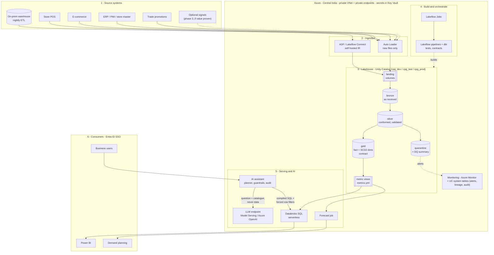
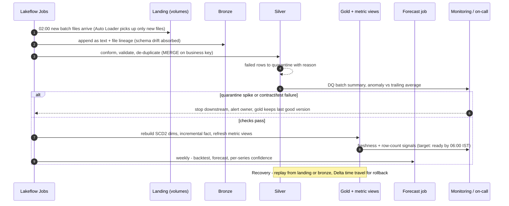
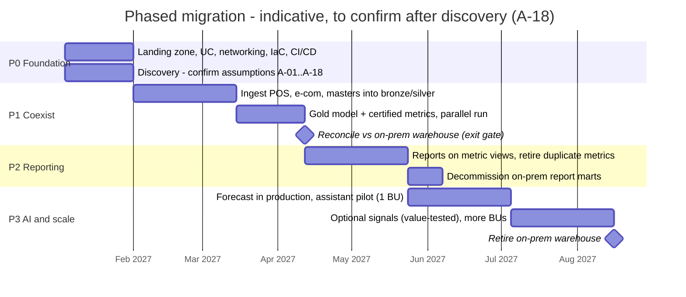

# Target architecture

How the client moves from fragmented on-prem and cloud data to one governed lakehouse with certified
metrics, forecasting and a constrained AI assistant – and how the PoC in this repository maps onto it.
Decisions are recorded in [ADRs](../adr/README.md); assumptions in the
[assumptions register](../requirements/assumptions_register.md).

## 1. Principles

1. **One definition per measure** – metrics are defined once (`metrics.yml` → Unity Catalog metric views) and every consumer reads them; nobody re-writes revenue.
2. **Contracts at every boundary** – inbound source contracts, an enforced outbound contract on the curated fact, versioned changes.
3. **Keep raw, replay anything** – landing and bronze are append-only; every downstream table can be rebuilt.
4. **Bad data is held, never dropped** – quarantine with a reason; closed periods change only through restatement.
5. **AI proposes, rules decide** – the LLM only plans; catalogue, access policy and SQL are deterministic.
6. **Open formats, managed governance** – Delta + dbt + YAML metrics stay portable; Unity Catalog governs (ADR-001).

## 2. Target architecture

Mermaid source (renders on GitHub)

| Layer | Target choice | Alternative considered | PoC substitute (same contract) |
|---|---|---|---|
| Ingestion – on-prem warehouse | ADF / Lakeflow Connect with a self-hosted integration runtime over private networking | Database replication (CDC tool) | – (synthetic extracts) |
| Ingestion – files and feeds | Auto Loader into UC volumes (schema evolution, rescued data) | ADF copy activities | `read_csv` over landing folders as dbt sources |
| Storage | ADLS Gen2 + Delta Lake, Unity Catalog managed tables | Snowflake storage (ADR-001) | DuckDB file |
| Transformation | Lakeflow Declarative Pipelines (bronze/silver, expectations) + dbt-databricks (gold, tests, contracts) | dbt on Snowflake | dbt-duckdb |
| Metrics | UC metric views generated from `metrics.yml` | dbt Semantic Layer | `metrics.yml` + compiler |
| Orchestration | Lakeflow Jobs | Airflow, ADF | Makefile |
| Serving | Databricks SQL serverless warehouse → Power BI | Snowflake warehouse | DuckDB + `make query` |
| Forecast | Scheduled job (Python) writing to gold | Databricks AutoML / ML runtime | `src/poc/forecast.py` |
| AI | Assistant service (planner, guardrails, audit) + Model Serving or Azure OpenAI | Databricks AI/BI Genie (less control over refusals) | `src/poc/insight` + offline planner |
| Governance | Unity Catalog grants, row filters, tags, lineage, audit | Purview + Snowflake Horizon | `access_policy.yml`, dbt lineage, JSONL audit |
| CI/CD | GitHub Actions + Databricks Asset Bundles + Terraform | Azure DevOps | GitHub Actions + Docker |

## 3. Security boundaries

| Boundary | Control |
|---|---|
| Network | Workspace in a customer-managed VNet (VNet injection); storage, Key Vault and SQL via **private endpoints**; no public access to storage; on-prem reached via ExpressRoute/VPN and a self-hosted IR |
| Identity | Entra ID SSO; SCIM-synced groups → Unity Catalog groups (A-15); service principals for jobs and CI; no personal tokens in pipelines |
| Authorisation | UC grants by layer (engineers write bronze/silver; only pipelines write gold); consumers read **metric views and gold only**; row filter on region for regional roles; sensitivity tags on commercially sensitive measures (A-16) |
| Secrets | Azure Key Vault-backed secret scopes; nothing in code or config |
| Data | Encryption at rest (platform keys; customer-managed keys if required); TLS in transit; no PII in scope (A-17); UAE residency open (A-14) |
| AI | LLM receives the question and catalogue metadata only – **never rows**; enterprise endpoint with no training on prompts; every request audited; refusals by deterministic rules |
| Change | All changes through pull requests and CI gates; production deploys by service principal only |

## 4. Operational flow (daily)

Mermaid source

On failure, downstream steps stop and **gold keeps the last good version**; the owner is alerted with
the failing check. Recovery is a replay from landing or bronze (append-only), or a Delta time-travel
restore for a bad deploy (see `docs/delivery/cicd.md`).

## 5. PoC → target mapping

| PoC component (this repo) | Production equivalent | What changes |
|---|---|---|
| `src/poc/generate_data.py` → `data/raw/landing` | Real feeds into UC volumes | Source-specific connectors; same folder contract |
| dbt bronze (`source()` + text-first read) | Auto Loader streaming tables | Incremental by file; rescued-data column |
| dbt silver incremental (delete+insert) | Delta `MERGE` / Lakeflow `APPLY CHANGES` | Same business key and rules |
| SCD2 from retained extracts | Same, or `APPLY CHANGES … STORED AS SCD TYPE 2` when sources send effective dates | A-08 |
| dbt gold + enforced contract | dbt-databricks, same models and contract | SQL dialect tweaks |
| `metrics.yml` + compiler | UC metric views generated from the same YAML | Compiler kept for the assistant |
| `forecast.py` | Scheduled job; MLflow for runs and metrics | Same models and backtest |
| `src/poc/insight` + offline planner | Assistant service + LLM endpoint | Identity from SSO; planner via LLM |
| `access_policy.yml` | UC groups, row filters, tags, metric-view grants | Same rules |
| `make`, Docker, GitHub Actions | Asset Bundles, Terraform, GitHub Actions | Environments dev/test/prod |

## 6. Phased migration

Mermaid source

| Phase | Goal | Exit criteria |
|---|---|---|
| **P0 Foundation** (~4 wks) | Landing zone, Unity Catalog, networking, IaC, CI/CD; discovery confirms A-01…A-18 | Assumptions signed off or changed; dev/test/prod deployable from CI |
| **P1 Coexist** (~8–10 wks) | Ingest POS, e-commerce and masters; build gold and certified metrics; **run in parallel** with the nightly on-prem ETL | Monthly net revenue reconciles with the on-prem warehouse within an agreed tolerance for 2 closed months; DQ alerts live |
| **P2 Move reporting** (~8 wks) | Reports switch to metric views; duplicate metric definitions retired; on-prem report marts decommissioned | No report computes revenue outside the catalogue; usage moved |
| **P3 AI and scale** (~8–12 wks) | Forecast in production, assistant pilot with one business unit, optional signals **only if they prove value** (forecast error drops), more BUs; retire the warehouse | Pilot acceptance (refusal accuracy, user feedback), forecast value added vs baseline, warehouse switched off |

The on-prem warehouse is never switched off before its numbers have been reproduced and reconciled
(P1 exit gate) – coexistence first, cut-over second.

## 7. Non-functional requirements

| NFR | Target (to confirm – A-13) | How it is met | Evidence in the PoC |
|---|---|---|---|
| **Scale** | Designed for ~100–300 M sales lines/year across business units | Incremental bronze/silver (new files only), `MERGE` on business key, liquid clustering on date/store/SKU, aggregation through metric views | Incremental run = full refresh (content hash); 230 k lines build in seconds |
| **Availability / freshness** | Curated data ready by 06:00 IST; SQL warehouse 99.5% in business hours | Serverless SQL; retries on jobs; gold keeps last good version on failure | Pipeline stops downstream on test failure (dbt skip) |
| **Security** | Private networking, SSO, least privilege | §3 | `access_policy.yml`, deny by default |
| **Access control** | Role-based metrics and row scope | UC grants, row filters, tags | Golden set: restricted and unauthorised cases |
| **Privacy** | No PII; LLM never sees rows | §3 (A-17) | Planner receives catalogue only; audit log |
| **Observability** | Every batch measured; alerts on anomalies, freshness, failures | DQ batch summary, anomaly test, UC system tables, Azure Monitor | `slv_dq_batch_summary`; warning fires on October incident |
| **Lineage** | Any number traceable to its source file | UC column lineage; `_source_file` on every row; dbt graph | dbt docs lineage from sources to exposures |
| **Data quality** | Bad rows held with a reason; contracts enforced | Quality rules in silver; dbt tests; contract on fact | 61 dbt tests; quarantine by reason |
| **Cost** | Within an agreed monthly budget per environment | §8 | – |
| **Recovery** | RPO 24 h / RTO 4 h for curated data (proposed) | Append-only landing and bronze → replay; Delta time travel 30 days; IaC rebuilds the workspace; storage with zone redundancy | `make all` rebuilds everything from landing |

## 8. Cost drivers and controls

Indicative prices are deliberately not quoted here: they depend on the client's Azure agreement and
current list prices and must be sized in discovery. What drives cost, and how it is kept down:

| Driver (largest first) | Control |
|---|---|
| SQL warehouse hours for BI and the assistant | Serverless with short auto-stop; one shared warehouse per environment; metric views and result cache reduce repeat scans |
| Pipeline compute for ingestion and transformation | Incremental processing only; job compute (not interactive); cluster policies; off-peak scheduling |
| Dev and test environments | Auto-stop, smaller sizes, sample data in dev |
| LLM calls | Planner sends short prompts (question + catalogue, no data); rate limits per user; offline planner as fallback |
| Storage | Small relative to compute; retention policy per layer (physical schema §1) |
| Governance | Tags per workstream and environment; budgets and alerts in Azure Cost Management; monthly FinOps review |

## 9. Extension points for receiving teams

| To add | Change | Owner / approver | Guarded by |
|---|---|---|---|
| A new source system | Inbound contract in `contracts/source_contracts.yml` → `landing` source → bronze model → mapping into `slv_sales_conformed` | Ingestion engineer; source owner signs the contract | dbt tests, reconciliation, quarantine monitoring |
| A new metric | Entry in `metrics.yml` with owner, unit, sensitivity | Metric owner (e.g. Finance) + architect | Compiler validation, `test_metrics.py` |
| A new dimension | `dimensions` entry (+ join if needed) | Modelling engineer | Totals-through-every-dimension test |
| A new role or access rule | `policies/access_policy.yml` | Data Governance + Security | Golden set, malicious-planner tests |
| A new forecast model | Function in `forecast.MODELS` | Forecast engineer | Backtest selection, leakage test |
| A new LLM provider | Planner class returning `QueryPlan` | AI engineer | Same guardrails and golden set |
| A new quality rule | Case in `slv_sales_conformed.dq_reason` + accepted values | Data engineer + rule owner | `accepted_values` test, monitoring |

## 10. Open questions

A-13 recovery targets, A-14 UAE data residency and A-18 phase durations need decisions before
Phase 1 – see the [assumptions register](../requirements/assumptions_register.md).
