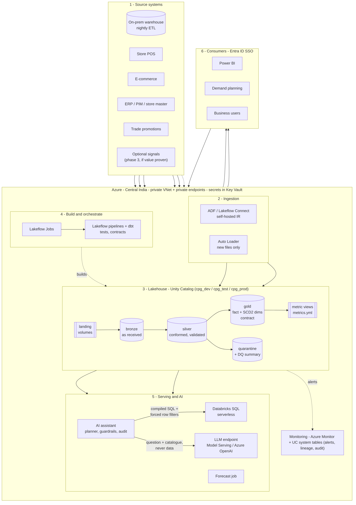
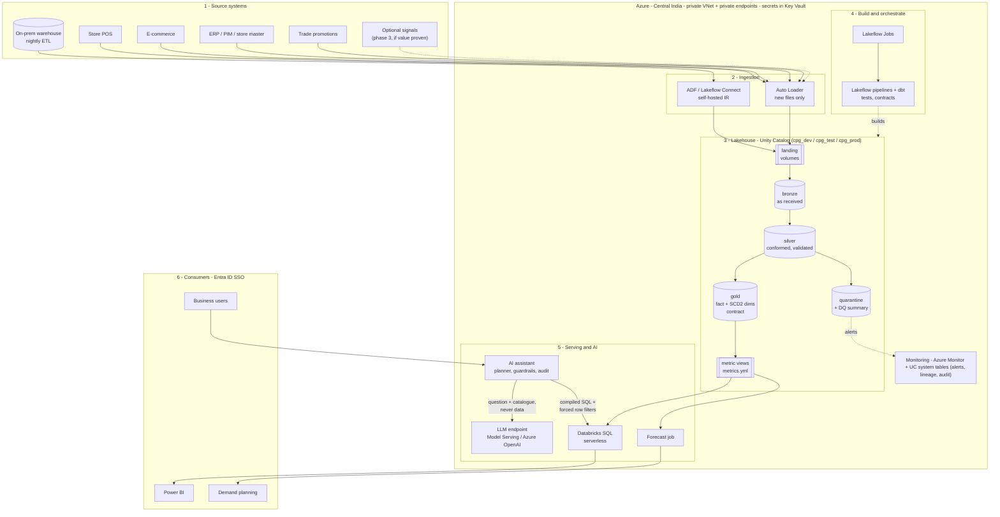
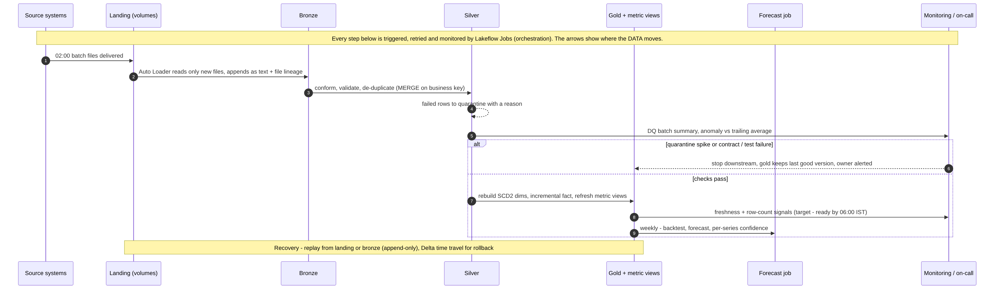
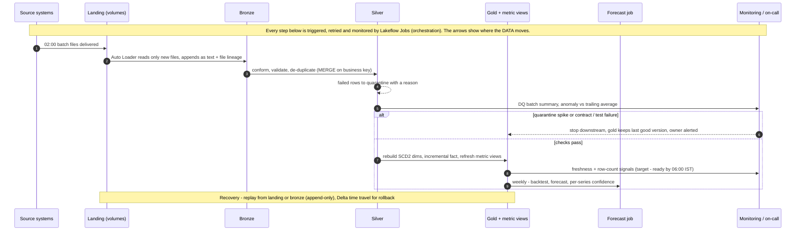
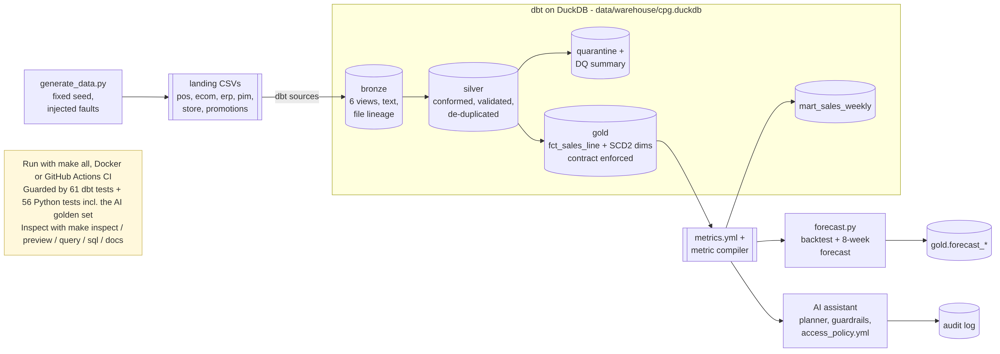
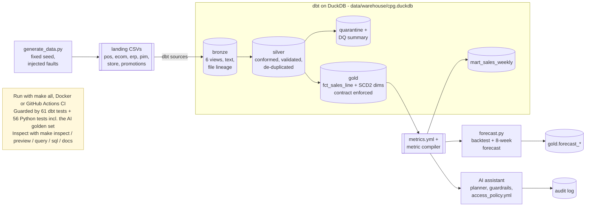
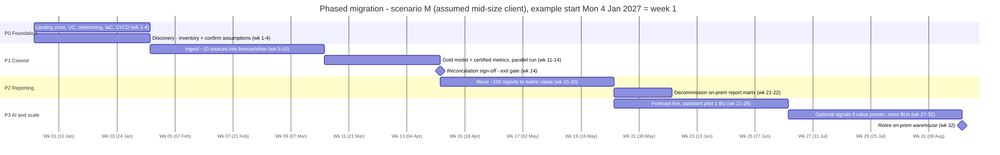
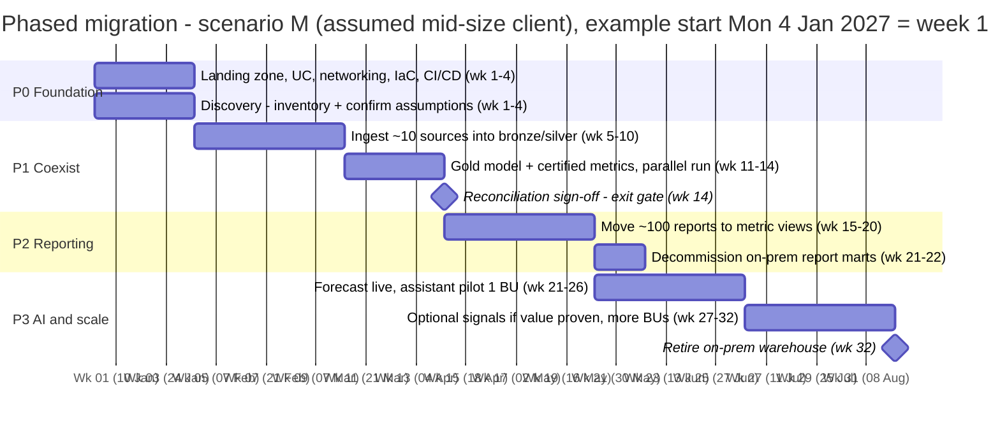

# Target architecture

How the client moves from fragmented on-prem and cloud data to one governed lakehouse with certified
metrics, forecasting and a constrained AI assistant – and how the PoC in this repository maps onto it.
Decisions are recorded in [ADRs](../adr/README.md); assumptions in the
[assumptions register](../requirements/assumptions_register.md).

## 1. Principles

1. **One definition per measure** – metrics are defined once (`metrics.yml` → Unity Catalog metric views) and every consumer reads them; nobody re-writes revenue.
2. **Contracts at every boundary** – inbound source contracts, an enforced outbound contract on the curated fact, versioned changes.
3. **Keep raw, replay anything** – landing and bronze are append-only; every downstream table can be rebuilt.
4. **Bad data is held, never dropped** – quarantine with a reason; closed periods change only through restatement.
5. **AI proposes, rules decide** – the LLM only plans; catalogue, access policy and SQL are deterministic.
6. **Open formats, managed governance** – Delta + dbt + YAML metrics stay portable; Unity Catalog governs ([ADR-001](../adr/ADR-001-lakehouse-platform.md)).

## 2. Target architecture

Mermaid source (renders on GitHub)

| Layer | Target choice | Alternative considered | PoC substitute (same contract) |
|---|---|---|---|
| Ingestion – on-prem warehouse | ADF / Lakeflow Connect with a self-hosted integration runtime over private networking | Database replication (CDC tool) | – (synthetic extracts) |
| Ingestion – files and feeds | Auto Loader into UC volumes (schema evolution, rescued data) | ADF copy activities | `read_csv` over landing folders as dbt sources |
| Storage | ADLS Gen2 + Delta Lake, Unity Catalog managed tables | Snowflake storage ([ADR-001](../adr/ADR-001-lakehouse-platform.md)) | DuckDB file |
| Transformation | Lakeflow Declarative Pipelines (bronze/silver, expectations) + dbt-databricks (gold, tests, contracts) | dbt on Snowflake | dbt-duckdb |
| Metrics | UC metric views generated from `metrics.yml` | dbt Semantic Layer | `metrics.yml` + compiler |
| Orchestration | Lakeflow Jobs | Airflow, ADF | Makefile |
| Serving | Databricks SQL serverless warehouse → Power BI | Snowflake warehouse | DuckDB + `make query` |
| Forecast | Scheduled job (Python) writing to gold | Databricks AutoML / ML runtime | `src/poc/forecast.py` |
| AI | Assistant service (planner, guardrails, audit) + Model Serving or Azure OpenAI | Databricks AI/BI Genie (less control over refusals) | `src/poc/insight` + offline planner |
| Governance | Unity Catalog grants, row filters, tags, lineage, audit | Purview + Snowflake Horizon | `access_policy.yml`, dbt lineage, JSONL audit |
| CI/CD | GitHub Actions + Databricks Asset Bundles + Terraform | Azure DevOps | GitHub Actions + Docker |

## 3. Security boundaries

| Boundary | Control |
|---|---|
| Network | Workspace in a customer-managed VNet (VNet injection); storage, Key Vault and SQL via **private endpoints**; no public access to storage; on-prem reached via ExpressRoute/VPN and a self-hosted IR |
| Identity | Entra ID SSO; SCIM-synced groups → Unity Catalog groups ([A-15](../requirements/assumptions_register.md#a-15)); service principals for jobs and CI; no personal tokens in pipelines |
| Authorisation | UC grants by layer (engineers write bronze/silver; only pipelines write gold); consumers read **metric views and gold only**; row filter on region for regional roles; sensitivity tags on commercially sensitive measures ([A-16](../requirements/assumptions_register.md#a-16)) |
| Secrets | Azure Key Vault-backed secret scopes; nothing in code or config |
| Data | Encryption at rest (platform keys; customer-managed keys if required); TLS in transit; no PII in scope ([A-17](../requirements/assumptions_register.md#a-17)); UAE residency open ([A-14](../requirements/assumptions_register.md#a-14)) |
| AI | LLM receives the question and catalogue metadata only – **never rows**; enterprise endpoint with no training on prompts; every request audited; refusals by deterministic rules |
| Change | All changes through pull requests and CI gates; production deploys by service principal only |

## 4. Operational flow (daily)

Mermaid source

**Read the arrows as data movement** – files go landing → bronze → silver → gold → forecast. Lakeflow Jobs
does not carry data; it **triggers, retries and monitors** each step (the note across the top).

On failure, downstream steps stop and **gold keeps the last good version**; the owner is alerted with
the failing check. Recovery is a replay from landing or bronze (append-only), or a Delta time-travel
restore for a bad deploy (see `docs/delivery/cicd.md`).

## 5. PoC → target mapping

What runs in this repository (`make all`, Docker or CI) – the same layers and contracts as the target,
on a laptop:

Mermaid source

Each PoC piece and its production equivalent:

| PoC component (this repo) | Production equivalent | What changes |
|---|---|---|
| `src/poc/generate_data.py` → `data/raw/landing` | Real feeds into UC volumes | Source-specific connectors; same folder contract |
| dbt bronze (`source()` + text-first read) | Auto Loader streaming tables | Incremental by file; rescued-data column |
| dbt silver incremental (delete+insert) | Delta `MERGE` / Lakeflow `APPLY CHANGES` | Same business key and rules |
| SCD2 from retained extracts | Same, or `APPLY CHANGES … STORED AS SCD TYPE 2` when sources send effective dates | [A-08](../requirements/assumptions_register.md#a-08) |
| dbt gold + enforced contract | dbt-databricks, same models and contract | SQL dialect tweaks |
| `metrics.yml` + compiler | UC metric views generated from the same YAML | Compiler kept for the assistant |
| `forecast.py` | Scheduled job; MLflow for runs and metrics | Same models and backtest |
| `src/poc/insight` + offline planner | Assistant service + LLM endpoint | Identity from SSO; planner via LLM |
| `access_policy.yml` | UC groups, row filters, tags, metric-view grants | Same rules |
| `make`, Docker, GitHub Actions | Asset Bundles, Terraform, GitHub Actions | Environments dev/test/prod |

## 6. Phased migration

**From where to where**

| | From (today) | To (target) |
|---|---|---|
| Storage and processing | On-prem data warehouse with a **nightly ETL**, plus files in cloud object storage | Azure Databricks **lakehouse** – Delta tables in bronze / silver / gold under **Unity Catalog** |
| Ingestion | Batch ETL jobs per source | Auto Loader (files) and Lakeflow Connect / ADF (on-prem), incremental, with source contracts |
| Metrics | **Each reporting team keeps its own definitions** of revenue and demand | **One certified metric catalogue** (metric views) used by reports, forecast and AI |
| Access and lineage | Per-system permissions, little lineage | Unity Catalog grants, row filters, tags, lineage and audit |
| Consumers | Reports on warehouse marts | Power BI on metric views, forecast job, governed AI assistant |

**Why reconcile with the on-prem warehouse before moving reports.** The warehouse produces the numbers
the business trusts and decides on today. If the new platform shows a different revenue with no
explanation, nobody will move to it. So in Phase 1 both run in parallel, and the new **monthly net
revenue** (the headline measure, at the level Finance closes and signs off) must match the warehouse
within an agreed tolerance for **two closed months** – or every difference must be explained by a
documented rule (for example, returns counted on the sale date instead of the processing date).
Only then do reports move (Phase 2).

Mermaid source

| Phase | Goal | Exit criteria |
|---|---|---|
| **P0 Foundation** (wk 1–4) | Landing zone, Unity Catalog, networking, IaC, CI/CD; discovery confirms [A-01](../requirements/assumptions_register.md#a-01)…[A-19](../requirements/assumptions_register.md#a-19) | Assumptions signed off or changed; dev/test/prod deployable from CI |
| **P1 Coexist** (wk 5–14) | Ingest POS, e-commerce and masters; build gold and certified metrics; **run in parallel** with the nightly on-prem ETL | Monthly net revenue reconciles with the on-prem warehouse within an agreed tolerance for 2 closed months; DQ alerts live |
| **P2 Move reporting** (wk 15–22) | Reports switch to metric views; duplicate metric definitions retired; on-prem report marts decommissioned | No report computes revenue outside the catalogue; usage moved |
| **P3 AI and scale** (wk 21–32) | Forecast in production, assistant pilot with one business unit, optional signals **only if they prove value** (forecast error drops), more BUs; retire the warehouse | Pilot acceptance (refusal accuracy, user feedback), forecast value added vs baseline, warehouse switched off |

### Sizing the migration – the durations depend on the client's size

The timeline above is **scenario M**, an assumed mid-size client. The real duration depends on what is
being migrated, which discovery (P0) measures first. A small estate really can be migrated in about a month;
a large one takes most of a year.

**What drives the duration**

| Driver | Why it matters | Mainly affects |
|---|---|---|
| **Volume** – TB on-prem + history to backfill | Backfill and reconciliation run time; storage layout | P1 |
| **Velocity** – daily batch vs intraday / streaming | Streaming ingestion and monitoring take longer to build and operate | P1, P3 |
| **Variety** – number of source systems and formats | Each source needs a contract, connector, mapping and tests | P1 (largest driver) |
| **Veracity** – how clean and trusted the sources are | Dirty or disputed data means more quality rules and longer reconciliation | P1, P2 |
| **Number of reports / dashboards** | Each one is re-pointed to metric views and checked by its owner | P2 |
| **Number of metric definitions in use** (incl. duplicates across teams) | Each one is reconciled and agreed with its owner | P1 exit gate, P2 |
| **Business units / countries** | Sign-offs, access groups, residency ([A-14](../requirements/assumptions_register.md#a-14)) | P2, P3 |
| **Organisation readiness** – Azure landing zone, security approvals, access to sources | Can dominate P0 regardless of data size | P0 |
| **Calendar constraints** – month-end close, freeze periods | The reconciliation needs Finance sign-off on closed months | P1 exit gate |

**Three scenarios (team: architect + 3 engineers)**

| | **S – small** | **M – mid-size (assumed in this plan)** | **L – large** |
|---|---|---|---|
| Volume | ≤ 1 TB | 5–20 TB | > 50 TB |
| Velocity | daily batch | daily batch, some intraday | near-real-time feeds |
| Variety (sources) | ≤ 5 | ~10 (POS, e-com, ERP, PIM, store, promotions, …) | 30+ |
| Reports | ≤ 20 | ~100 | 300+ |
| Metric definitions to reconcile | ≤ 10 | 20–40 (with duplicates across teams) | 100+ |
| Business units / countries | 1 / 1 | 3–5 / 2 | many / many |
| **P0–P2 (core migration)** | **~4–6 weeks** (≈ 1 month if the Azure landing zone and approvals already exist) | **~22 weeks** | **~9–12 months, more than one pod** |
| P3 (AI, forecast, scale) | 2–4 weeks | ~10 weeks | phased per BU |
| Critical path | Finance sign-off on reconciliation, not engineering | Source onboarding (variety) | Variety + organisation |

**How the estimate is made (planning heuristics – calibrated in discovery)**

1. **Inventory** in P0: count sources, reports, metric definitions, data volume, feed frequency, BUs.
2. **Effort per unit** (starting heuristics): new source ≈ 1–2 engineer-weeks; report re-point and check ≈ 0.5 day;
   metric reconciliation ≈ 1–2 days; foundation ≈ 2–8 engineer-weeks depending on what already exists.
3. **Divide by capacity** (3 engineers, ~80% on delivery) and add **calendar constraints** (two closed months for
   reconciliation can use backfilled history, but one live month-end in parallel is recommended).
4. **Re-estimate** after the first two sources are onboarded – actual effort per source replaces the heuristic.

*Scenario M check:* ~10 sources × 1.5 wk + ~100 reports × 0.5 day + ~30 metrics × 1.5 days + foundation, model,
forecast and AI ≈ 60–65 engineer-weeks ÷ ~2.4 effective engineers ≈ 26 weeks, plus calendar buffer → the
~32-week plan above.

The on-prem warehouse is never switched off before its numbers have been reproduced and reconciled
(P1 exit gate) – coexistence first, cut-over second.

## 7. Non-functional requirements

| NFR | Target (to confirm – [A-13](../requirements/assumptions_register.md#a-13)) | How it is met | Evidence in the PoC |
|---|---|---|---|
| **Scale** | Designed for ~100–300 M sales lines/year across business units | Incremental bronze/silver (new files only), `MERGE` on business key, liquid clustering on date/store/SKU, aggregation through metric views | Incremental run = full refresh (content hash); 230 k lines build in seconds |
| **Availability / freshness** | Curated data ready by 06:00 IST; SQL warehouse 99.5% in business hours | Serverless SQL; retries on jobs; gold keeps last good version on failure | Pipeline stops downstream on test failure (dbt skip) |
| **Security** | Private networking, SSO, least privilege | §3 | `access_policy.yml`, deny by default |
| **Access control** | Role-based metrics and row scope | UC grants, row filters, tags | Golden set: restricted and unauthorised cases |
| **Privacy** | No PII; LLM never sees rows | §3 ([A-17](../requirements/assumptions_register.md#a-17)) | Planner receives catalogue only; audit log |
| **Observability** | Every batch measured; alerts on anomalies, freshness, failures | DQ batch summary, anomaly test, UC system tables, Azure Monitor | `slv_dq_batch_summary`; warning fires on October incident |
| **Lineage** | Any number traceable to its source file | UC column lineage; `_source_file` on every row; dbt graph | dbt docs lineage from sources to exposures |
| **Data quality** | Bad rows held with a reason; contracts enforced | Quality rules in silver; dbt tests; contract on fact | 61 dbt tests; quarantine by reason |
| **Cost** | Within an agreed monthly budget per environment | §8 | – |
| **Recovery** | RPO 24 h / RTO 4 h for curated data (proposed) | Append-only landing and bronze → replay; Delta time travel 30 days; IaC rebuilds the workspace; storage with zone redundancy | `make all` rebuilds everything from landing |

## 8. Cost drivers and controls

Indicative prices are deliberately not quoted here: they depend on the client's Azure agreement and
current list prices and must be sized in discovery. What drives cost, and how it is kept down:

| Driver (largest first) | Control |
|---|---|
| SQL warehouse hours for BI and the assistant | Serverless with short auto-stop; one shared warehouse per environment; metric views and result cache reduce repeat scans |
| Pipeline compute for ingestion and transformation | Incremental processing only; job compute (not interactive); cluster policies; off-peak scheduling |
| Dev and test environments | Auto-stop, smaller sizes, sample data in dev |
| LLM calls | Planner sends short prompts (question + catalogue, no data); rate limits per user; offline planner as fallback |
| Storage | Small relative to compute; retention policy per layer (physical schema §1) |
| Governance | Tags per workstream and environment; budgets and alerts in Azure Cost Management; monthly FinOps review |

## 9. Extension points for receiving teams

The brief's non-functional requirements ask that *"ownership, contracts, and extension points for the
receiving teams are documented."* This section is the extension-point part: how the team that inherits
the platform adds to it safely, who approves, and which test protects the change.

| To add | Change | Owner / approver | Guarded by |
|---|---|---|---|
| A new source system | Inbound contract in `contracts/source_contracts.yml` → `landing` source → bronze model → mapping into `slv_sales_conformed` | Ingestion engineer; source owner signs the contract | dbt tests, reconciliation, quarantine monitoring |
| A new metric | Entry in `metrics.yml` with owner, unit, sensitivity | Metric owner (e.g. Finance) + architect | Compiler validation, `test_metrics.py` |
| A new dimension | `dimensions` entry (+ join if needed) | Modelling engineer | Totals-through-every-dimension test |
| A new role or access rule | `policies/access_policy.yml` | Data Governance + Security | Golden set, malicious-planner tests |
| A new forecast model | Function in `forecast.MODELS` | Forecast engineer | Backtest selection, leakage test |
| A new LLM provider | Planner class returning `QueryPlan` | AI engineer | Same guardrails and golden set |
| A new quality rule | Case in `slv_sales_conformed.dq_reason` + accepted values | Data engineer + rule owner | `accepted_values` test, monitoring |

## 10. Open questions

Decisions the architecture cannot make on its own; each needs its owner's answer before Phase 1
(details in the [assumptions register](../requirements/assumptions_register.md)):

| ID | Open question | Decided by | Why it matters |
|---|---|---|---|
| [A-13](../requirements/assumptions_register.md#a-13) | Recovery targets (RPO / RTO) per consumer | Business owners + Platform team | Decides how much backup and DR to build |
| [A-14](../requirements/assumptions_register.md#a-14) | Data residency for the second country | Legal / Compliance + Security | May require a regional workspace or aggregate-only transfer. Arises from the PoC's two-country assumption ([A-11](../requirements/assumptions_register.md#a-11): India + UAE, chosen to test multi-currency and time zones – the brief names no countries) |
| [A-18](../requirements/assumptions_register.md#a-18) | Phase durations | Programme sponsor | Budget and plan – follow from [A-19](../requirements/assumptions_register.md#a-19) |
| [A-19](../requirements/assumptions_register.md#a-19) | Current-state size (volume, velocity, variety, veracity, reports, metric definitions) | Client IT + BI team | Moves the core migration between ~1 month (scenario S) and most of a year (scenario L) |
