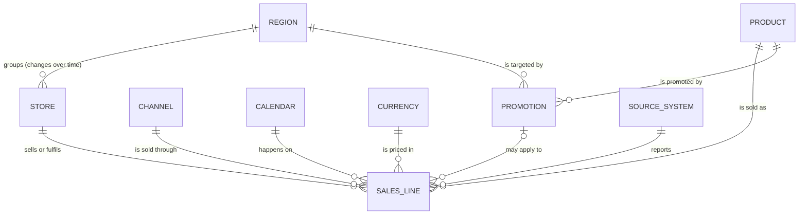

# Conceptual data model

Business entities and how they relate – no technology, no columns. This is the shared vocabulary
agreed with the business before any table is designed.

Mermaid source (renders on GitHub)

## Entities

| Entity | Definition (business language) | Source of truth | Changes over time? |
|---|---|---|---|
| **Sales line** | One product line on a sale or a return, as reported by a selling system. Returns are sales lines with negative quantity. | POS (stores), e-commerce platform | Corrected or re-sent by sources; late arrivals |
| **Product** | A sellable item (SKU) with brand, category, pack size and lifecycle status | ERP (identity, pack, status) + PIM (brand, category) – [A-03](../requirements/assumptions_register.md#a-03) | Yes – category reclassification, pack changes, discontinuation |
| **Store** | A physical store; online orders are attributed to the store that fulfils them ([A-07](../requirements/assumptions_register.md#a-07)) | Store master (Sales Ops) | Yes – a store can be reassigned to another region |
| **Region** | Commercial grouping of stores with an accountable regional manager | Sales Ops | Membership changes via Store |
| **Channel** | How the sale happened: in store or online | Derived from the selling system | No |
| **Calendar** | Days, weeks and the fiscal calendar (April start, 4-4-5) | Finance ([A-04](../requirements/assumptions_register.md#a-04)) | Fixed per year |
| **Promotion** | A discount on a product in a region for a date range | Trade promotion system | Planned in advance |
| **Currency rate** | Conversion of local currency to the reporting currency (INR) | Treasury ([A-06](../requirements/assumptions_register.md#a-06)) | Monthly |
| **Source system** | The system that reported a line – needed to keep its identity unique and traceable | – | – |

## Business rules captured at this level

- A sales line is identified by **source system + transaction + line number** – two systems may reuse the same transaction number.
- Revenue and demand are **measures over sales lines** (defined once in the metric catalogue), not attributes of any entity.
- When a store moves region, **past sales stay with the old region** for reporting (as-was, [A-02](../requirements/assumptions_register.md#a-02)); planning may view them under today's region (as-is, [A-12](../requirements/assumptions_register.md#a-12)).
- Customers and people are **out of scope** ([A-17](../requirements/assumptions_register.md#a-17)).

Next level: [logical_model.md](logical_model.md) · then [physical_schema.md](physical_schema.md).
