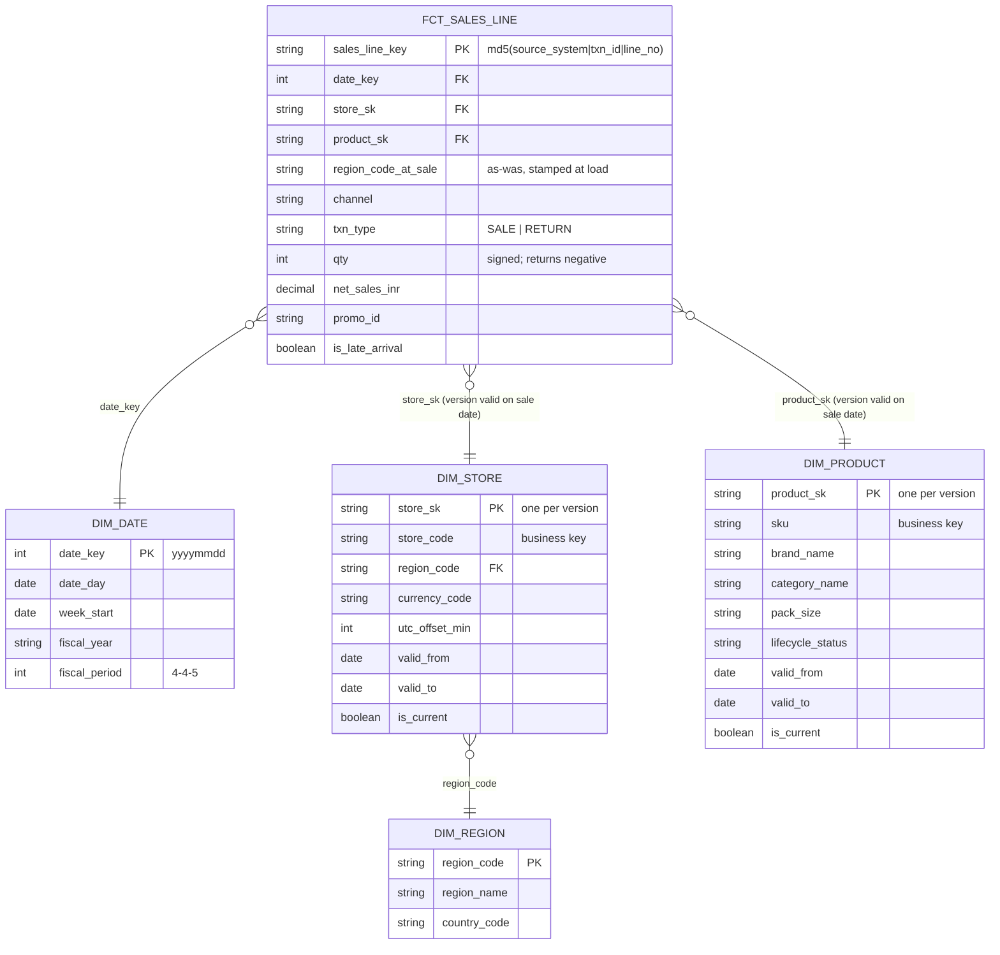

# Logical data model

Entities from the [conceptual model](conceptual_model.md) with keys, grain, attributes and history
handling – still independent of any database. The PoC implements it in `gold`; see
[physical_schema.md](physical_schema.md).

Mermaid source (renders on GitHub)

## Entity specifications

| Logical entity | Grain (one row =) | Business key | Surrogate key | History | Key attributes |
|---|---|---|---|---|---|
| **Sales line fact** | one sale or return line event | source_system + source_txn_id + source_line_no | `sales_line_key` (hash of the business key) | Append + correct: latest version per key wins; closed periods change only via restatement ([ADR-004](../adr/ADR-004-late-data-and-corrections.md)) | event date (local) and time (UTC), store, product, region at sale, channel, type, signed qty, local price, currency, FX rate, gross/returns/net INR, promotion, late flag, lineage (batch, ingested_at) |
| **Product** | one version of a SKU | `sku` | `product_sk` = hash(sku, valid_from) | **SCD2** on brand, category, pack size, lifecycle status ([ADR-002](../adr/ADR-002-history-and-attribution.md)) | name, brand, category, pack size, launch date, status |
| **Store** | one version of a store | `store_code` | `store_sk` = hash(store_code, valid_from) | **SCD2** on region, name, currency, time zone | name, region, currency, UTC offset |
| **Region** | region | `region_code` | – | Type 1 (reference) | name, country, manager role |
| **Calendar** | day | `date_key` | – | Static | week, month, fiscal year / quarter / week / period |
| **Promotion** | promotion × SKU × region | `promo_id` | – | Planned calendar (append) | SKU, region, start, end, discount % |
| **FX rate** | month × currency | month_start + currency | – | Append monthly | rate to INR |

## Measures (defined once – `metrics/metrics.yml`)

| Measure | Formula over sales lines | Additive? |
|---|---|---|
| gross_sales, returns_value, net_revenue, promo_revenue | sums of INR amounts | Yes |
| units_sold, units_returned, net_units | sums of quantities | Yes |
| return_rate, avg_selling_price, promo_revenue_share | ratio of two additive measures, computed **after** aggregation | **No** – never sum or average |

## Modelling rules

1. **Grain first:** the fact is at line-event grain so returns, corrections and promotions can be handled per line; every coarser view is an aggregation through the metric compiler.
2. **Facts join dimensions as-was** through surrogate keys chosen by the sale date; as-is uses `is_current`.
3. **Signed quantities:** one convention (returns negative) regardless of how each source sends returns.
4. **Late and corrected data** never edits a closed period silently ([A-05](../requirements/assumptions_register.md#a-05), [ADR-004](../adr/ADR-004-late-data-and-corrections.md)).
5. **No derived measure is stored as a column** that consumers might re-aggregate wrongly; ratios live only in the catalogue.

## Layer responsibilities

| Layer | Responsibility | Contract |
|---|---|---|
| Bronze | as received, all text, file lineage | inbound contracts (`contracts/source_contracts.yml`) |
| Silver | conformed, typed, validated, de-duplicated; history inputs | internal |
| Gold | this logical model (fact + dimensions) | outbound contract (`contracts/fct_sales_line.yml`, enforced) |
| Marts / metrics | consumption shapes, only via the metric catalogue | `metrics/metrics.yml` |
